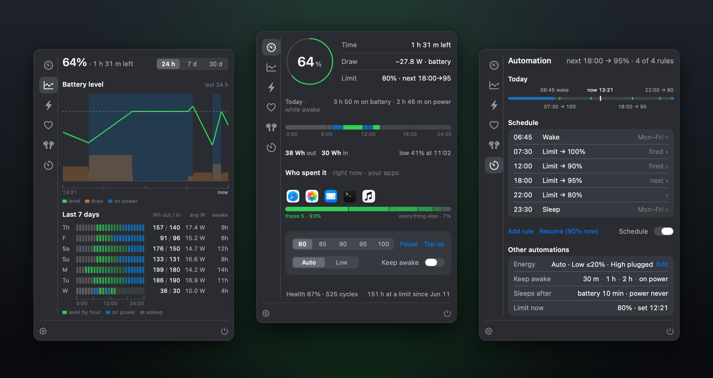
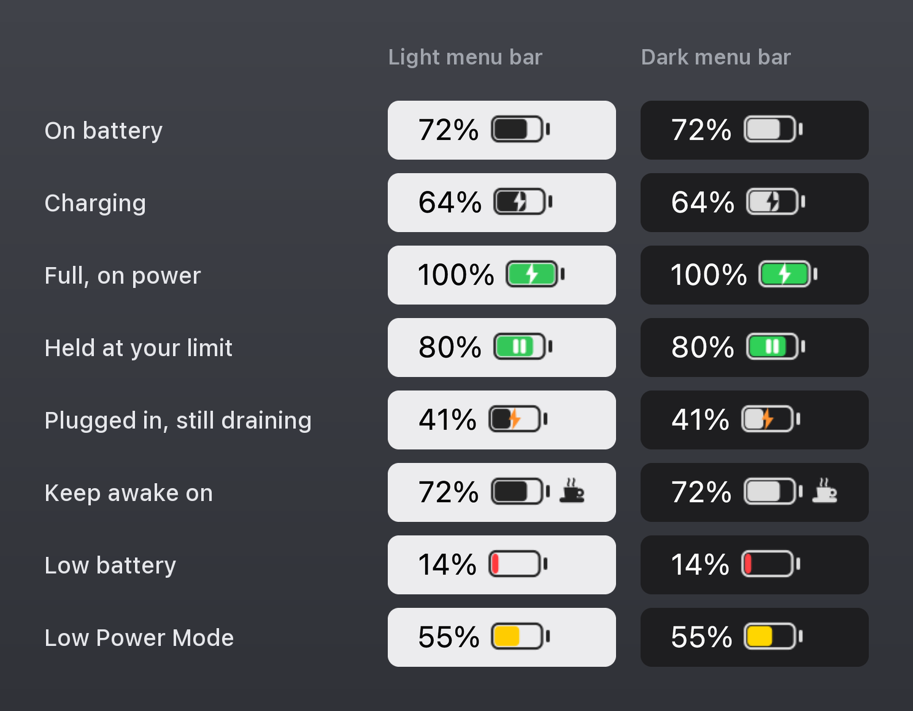
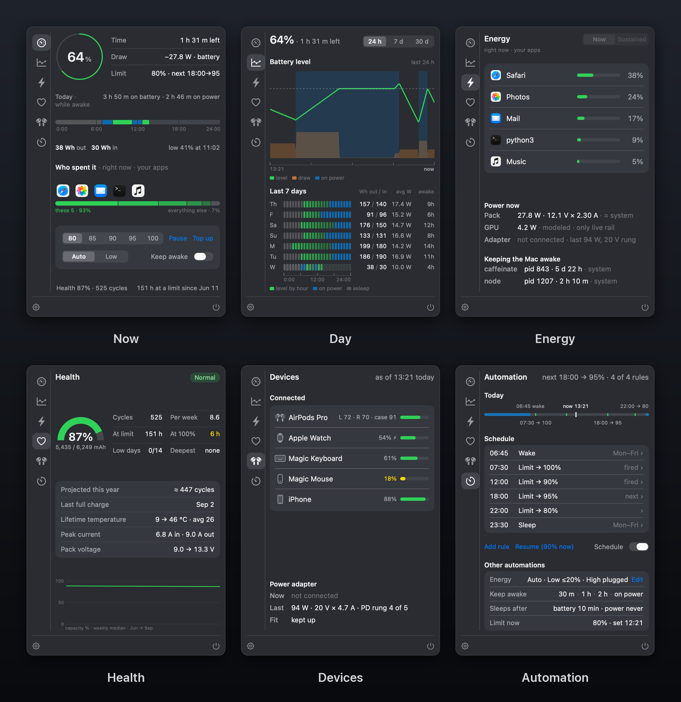
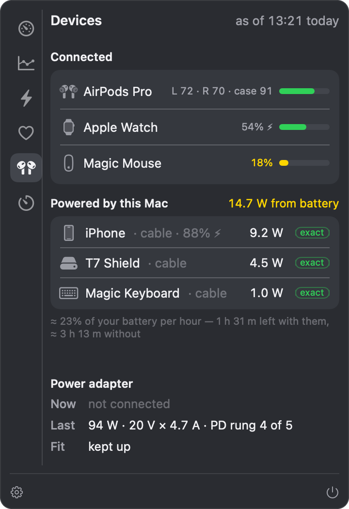

# Battery

A menu-bar battery app for Apple Silicon Macs that shows what the battery is actually doing — and says so when it
can't tell.



macOS 27 can report "not charging" while the battery is filling up. Battery watches the percentage instead. It holds charging at a limit through Apple's Charge Limit (macOS 26.4 and later), via Shortcuts you create — never by writing to
the battery controller. It also shows which apps are spending the battery, how healthy the pack is, what your USB-C ports are
powering and what that costs, and keeps the Mac awake on request (with the lid open). Anything it cannot read is shown
as "—" or says so in words, never as a guess.

Free, open source (GPL-3.0), no account, no telemetry, no third-party dependencies. It is one person's project, built
for and tested on one Mac — read *What it is not* before you build it.

## What it is not

- **Not a download.** There is no Developer ID behind it, so there is no notarized app to download. You build it
  yourself with Xcode; the steps are below.
- **Not widely tested.** Built and tested on one MacBook Pro (M4 Max) running macOS 26.6 through 27.2. The project's
  deployment target is macOS 14, but nothing older than 26.6 has been run. Charge limiting needs macOS 26.4 or later;
  on older systems it is built to only monitor (untested).
- **Not built on public APIs alone.** Several readings come from undocumented battery-registry keys and private
  frameworks (listed under *How it reads the Mac*). A macOS update can move them. The app then shows "—" instead of a
  wrong number, but that reading stops working until the code catches up.
- **Not an SMC tool.** Nothing in it writes to the battery controller. Charge limits go through Apple's own Charge
  Limit setting, so the Mac's own protections stay in charge.
- **Not for Intel Macs, and not below 80%.** The build is Apple Silicon only, and the limits are Apple's Charge Limit
  steps: 80, 85, 90, 95 or 100%.

## The menu bar



The icon is drawn by the app, so by default its fill follows the charge continuously.

| You see | It means |
|---|---|
| Bolt cut into the battery | Charging: the system's charging flag is on, **or** the percentage has risen recently while plugged in |
| Green battery with a white bolt | Full, on power |
| Green battery with two white bars | Holding at your charge limit, confirmed |
| Orange bolt | Plugged in but still draining: no recent rise in the percentage, and the sampled battery current at −350 mA or lower |
| Red | 20% or less, and no charging bolt |
| Yellow | Low Power Mode is on (yellow replaces green; red outranks it) |
| Espresso cup | Keep-awake is running; a cup with no steam means the Mac slept through it anyway |

Right-click it for quick actions: set the limit, pause charging (it holds at the current step, never below 80%) or resume, top up to
100%, keep awake, the schedule.

## The six tabs



**Now** — charge, time left (plugged in: time to your limit, from the measured inflow), the battery's flow in watts (out on battery, in on power), the
limit, today's battery-versus-power strip with energy out and in, the five apps that spent the most, and the controls.

**Day** — the last 24 hours, 7 days or 30 days: charge level, power draw, time on power and the limit line, plus a
seven-day grid of hourly charge level and time on power.

**Energy** — who is drawing power right now (each of your processes' own energy counter, sampled twice half a second
apart) and over a longer window (`powermetrics`' energy impact — a unitless share, never shown as watts). Battery, GPU
and adapter power, and what is keeping the Mac awake, with a Quit button for apps that are.

**Health** — health as the pack's real full-charge capacity over its design capacity (not the system's rounded
figure), cycles, the condition flag, hours at your limit and at 100%, low days, and capacity week by week.

**Devices** — AirPods, Watch, keyboard and mouse batteries; an iPhone's exact percentage over the same link Finder uses;
and **Powered by this Mac**: the watts each USB-C port is supplying, measured by the Mac itself, and on battery what
that costs you per hour. A short notice appears when something starts drawing power while you're on battery.



**Automation** — up to four daily charge-limit rules ("07:30 → 100%, 22:00 → 80%"), a sleep and wake schedule,
keep-awake presets, and automatic Low Power Mode on a low battery. Power Nap and wake-for-network, per power source,
are in Settings → Automation.

## Why it watches the percentage

On macOS 27.0 the battery registry refreshed about once per percent step — roughly every 50 seconds while charging — and
in between it could keep showing a reading that says *not charging, draining* while the battery is filling. Measured on the
development Mac under macOS 27.0: each refresh showed about one second of `IsCharging = Yes` at +3694 mA, then
`IsCharging = No` at −1763 mA until the next step, while the remaining capacity rose from 1421 to 1643 mAh in three
minutes. The app's own history logged "discharging" for 51 of 60 minutes of one charge.

So the bolt, and every charging figure in the popover, follow the **percentage trend**: a rise while plugged in is held
for 1.5× the gap between the last two steps (between 90 and 300 seconds), the inflow is measured from the capacity
climb, and a confirmed limit hold overrides the trend. The full write-up, with the other macOS 27 changes, is in
[docs/MACOS-27.md](docs/MACOS-27.md).

## The root helper has no code to reach the battery controller — and a build gate checks it

A few features need root: switching energy mode, the sleep and wake schedule, Power Nap and wake-for-network, and
`powermetrics`.
They go through a small privileged helper: an `SMAppService` daemon that launchd starts at boot and keeps running while it
is registered (four source files of its own plus the shared command and signing code in `shared/`) whose whole interface is five
XPC calls taking only integers and booleans. The helper builds every command's arguments itself and runs them with
`posix_spawn` — no shell — under a 30-second timeout.

It accepts a call only from a client that passes a code-signing requirement, checked by audit token: the same
identifier, signed by the same team, at version 1.1 or later (a floor raised by hand whenever an older build becomes unsafe to
trust), and **not** debuggable or open to library injection
(no `get-task-allow`, no DYLD environment, no disabled library validation). The app is built without those
entitlements in every configuration. `scripts/install-release.sh` installs a verified Release build root-owned in
`/Applications`. `scripts/purge-old-builds.sh` lists any Battery builds below that floor in this checkout and in
Xcode's DerivedData, and `--delete` removes them, so none is left for anything to borrow. The rule trusts whoever can sign as your team — in practice, the signing key in your login keychain.

`scripts/smc-dead-gate.sh` runs after every helper build and fails it if the helper's sources or binary show any
way to reach the battery controller:

1. no SMC or charge-inhibit source in the helper's build;
2. no SMC symbols or key strings (`CHTE`, `CH0B`, `CH0C`, `BCLM`, `CHWA`) in the binary;
3. no IOKit link;
4. no dynamic loading (`dlopen`, `dlsym`);
5. the gate itself still wired into the build;
6. hardened process spawning: `posix_spawn` with close-on-exec, a kill path, and no shell.

## How it is tested

- **2,291 unit tests**, logic only, no host app. Three of them read git history: one names a commit from the project's private history and
  always skips, and two skip unless the checkout has at least two commits (a ZIP download or a shallow clone has
  fewer). One more skips until `scripts/install-release.sh` has built and verified a Release app. Expect 0 failures.
- **A clip gate.** `Battery --render-pages <dir>` renders every popover page with test data inside its real frame and
  judges each one (fits, clipped, truncated, scrolls). A page whose verdict changes fails the run. It is
  not part of `xcodebuild test`; run it by hand with `build/sym/Debug/Battery.app/Contents/MacOS/Battery --render-pages
  <dir>` (it draws nothing on screen and doesn't start the helper; exit 0 means every verdict is as expected, 1 that one
  changed, 2 a harness error).
- **A dead-readout gate.** `scripts/ui-orphan-gate.sh` fails when a UI-facing value (found by a naming heuristic) has no
  reader in another file, so a readout is much less likely to go dark unnoticed.
- **"Unread is not zero."** A failed read is its own state everywhere: "—" on screen, never a default that looks like a
  fact. Stored history and settings are never written over when they can't be read; a deliberate change of yours
  first moves the unreadable copy aside, and the app keeps it.

## Build it yourself

You need an Apple Silicon Mac; Xcode (built with Xcode 27.1 on macOS 27.2; `xcode-select -p` must point at Xcode.app,
not the Command Line Tools, and `scripts/install-release.sh` uses `/Applications/Xcode.app` unless you set
`DEVELOPER_DIR`); [XcodeGen](https://github.com/yonaskolb/XcodeGen) (`brew install xcodegen`); and an
Apple ID added to Xcode with an **Apple Development** certificate (Xcode → Settings → Accounts → Manage Certificates →
+). A free Personal Team is enough. Signing is manual, so the certificate has to exist before you build.

1. **Set your Team ID** after `DEVELOPMENT_TEAM =` in `Signing.xcconfig`, in the file itself: `scripts/install-release.sh`
   and `scripts/purge-old-builds.sh` read it from there, so passing `DEVELOPMENT_TEAM=` to `xcodebuild` is not enough.
   The comment in that file shows how to find it.
2. **Build and test** (build first, then test). This Debug build is for the tests only, so don't open it: the app
   registers its root helper from whichever copy you open, and `build/` is a folder you can write to.
   ```sh
   xcodegen generate
   xcodebuild -scheme Battery -configuration Debug SYMROOT="$(pwd)/build/sym" build
   xcodebuild -scheme Battery -configuration Debug SYMROOT="$(pwd)/build/sym" test
   ```
3. **Install** a verified Release build. The first command builds and checks it; the second asks for your password
   and installs that same build root-owned (quit Battery first if it is running):
   ```sh
   scripts/install-release.sh
   scripts/install-release.sh --install --skip-build
   ```
4. **Open `/Applications/Battery.app`.** macOS asks once to allow its background item (System Settings → General →
   Login Items & Extensions); that is the helper. If you opened a copy under `build/` before installing, follow
   the NEXT STEPS the installer prints to move the helper to the `/Applications` copy.
5. **For charge limits**, create these shortcuts in the Shortcuts app, each holding only the built-in
   *Set Battery Charge Limit* action at that value (the system's action, **not** this app's own
   "Set Charge Limit", which the picker also offers): `Battery Limit 80`, `Battery Limit 85`, `Battery Limit 90`,
   `Battery Limit 95`, `Battery Limit 100`, and — recommended — `Battery Limit Get` holding *Get Battery Charge Limit*.
   Settings → General walks you through it, and macOS asks once for permission the first time the app runs one. The
   app runs whatever a shortcut with those names does and checks only the result (the limit it reads back, or,
   without `Battery Limit Get`, how the battery behaves), so keep them as described.

The bundle identifiers start with `com.example`. Changing that is optional; to use your own prefix, change it in every
file `grep -rl com.example --exclude-dir=build --exclude-dir=Battery.xcodeproj .` lists (project.yml, the Info.plists,
`shared/SharedConstants.swift`, a few Swift sources such as the helper's state-folder path,
the scripts and the tests that pin it).

## How it reads the Mac

| Reading | Source | Public API? |
|---|---|---|
| Charge, time left, power source | IOKit power sources | yes |
| Voltage, current, capacities, health | the `AppleSmartBattery` registry entry | undocumented keys |
| Watts out per USB-C port | `AppleSmartBattery` → `PowerOutDetails` | undocumented key |
| Accessory batteries | `IOPSCopyPowerSourcesByType`, looked up at run time | exported, not in the SDK headers |
| iPhone battery | MobileDevice (the Finder link; needs *Trust This Computer*), and the Instant Hotspot beacon via Sharing | private frameworks |
| Per-app energy | `proc_pid_rusage` energy counter, your own processes only | in the SDK, but `libproc.h` calls it a private interface |
| Sustained energy impact | `powermetrics`, through the helper | yes (root) |
| GPU power | IOReport, loaded at run time | private library |
| Charge limit | Apple's Charge Limit, through your Shortcuts | yes |

## Uninstall

Settings → General → **Uninstall Battery…** sets the charge limit back to 100%, Energy Mode back to Automatic, clears
the sleep and wake schedule, unregisters the helper and the login item, and removes the app's own settings and
history. Then run `sudo scripts/uninstall-residue.sh` to remove the helper's root-owned folder in
`/Library/Application Support/com.example.batteryapp` (it refuses while a repeating sleep/wake schedule is still set,
and prints how to clear it), and move `/Applications/Battery.app` to the Trash; Finder asks for an admin password,
because the installed copy is root-owned.

## Known issues

- A device that only charges (no data connection) can draw 6–12 W from a port while macOS 27.2 reports that port's
  filtered power as 0, so *Powered by this Mac* leaves it out.
- AirPods Max can appear twice on the Devices tab — as a Bluetooth battery and as a powered USB device. The two share no
  identifier, so the app does not guess that they are the same.
- With two iPhones on power at once (through a powered hub, or swapped on the same port), one can be shown with the wrong
  name.
- Keep-awake holds off idle sleep only. Closing the lid or choosing Sleep still sleeps the Mac; the cup then loses its
  steam.
- A few timing tests can fail under heavy parallel build load and pass when run alone.

## About the source

Comments in the code cite the project's design notes — spec sections, decision ids like `G-7`, review rounds — which
are kept privately and are not part of this repository. The code and tests stand on their own; the citations say where
a rule came from.

## License

GNU General Public License, version 3 or (at your option) any later version — see [LICENSE](LICENSE).
Copyright (c) 2026 XBTDMT. The first public version (2026-10-18) was released under the MIT License, and copies taken
from it keep that license; later versions are GPL-3.0-or-later.

An early, since-deleted version of the helper adapted the SMC call protocol from
[Battery Toolkit](https://github.com/mhaeuser/Battery-Toolkit) (BSD-3-Clause); see [NOTICES](NOTICES).
